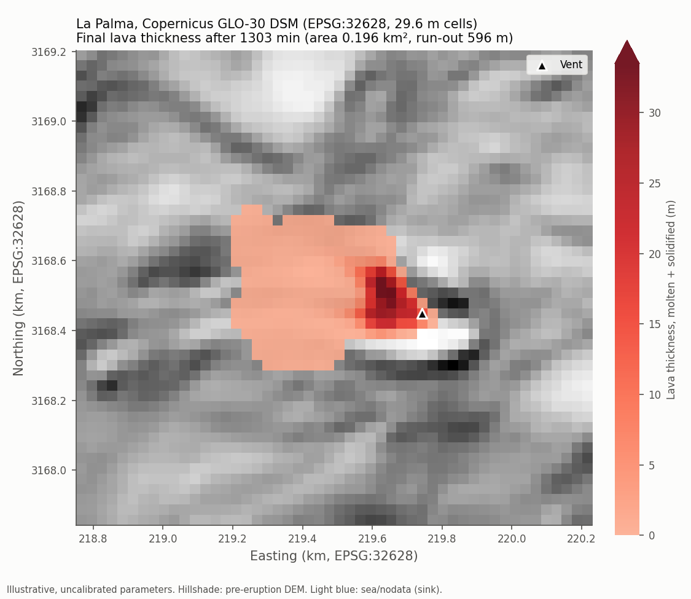

# La Palma Lava Flow Simulation

A simple cellular-automaton (CA) lava flow simulator, inspired by the 2021 eruption of
Cumbre Vieja (La Palma, Canary Islands). It runs on a synthetic Gaussian hill or on the
Copernicus GLO-30 surface model of La Palma.

> **Status.** This is an educational/exploratory model. Its parameters are illustrative
> and **have not been calibrated**, and its output **has not been validated** against
> observed lava flows. See [Limitations](#limitations).

> **Illustrative scenario, not a reconstruction.** The La Palma runs place a vent at the
> Tajogaite cone on pre-eruption topography and erupt a few hundred thousand m³ over
> about a day. They do **not** reproduce the 2021 eruption: its ~85-day duration, its
> changing effusion rate, its multiple vents, or the flow field that reached the sea. The
> simulated footprint should not be read as a hindcast of the 2021 lava flows.



*Illustrative run on the Copernicus GLO-30 DSM of La Palma, with the vent at the
Tajogaite cone (command below): molten + solidified lava thickness over a hillshade of
the pre-eruption surface,
after three 6-hour pulses at 600 m³/min. Uncalibrated parameters. Footprint
0.196 km², straight-line run-out 596 m.*

## What the model does

The DEM is a regular grid of square cells of side `L` (m). Time advances in steps of
`dt = 1 min`. Each cell stores the active (molten) lava thickness `h`, the heat
content `h·T`, and the solidified lava thickness `s`. Every step does the following:

1. **Emission.** The vent cell receives `Q·dt / L²` of lava at the eruption
   temperature `T0`.
2. **Newtonian cooling.** `T ← Ta + (T − Ta)·exp(−k·dt)`, applied to every cell holding
   lava.
3. **Viscosity and mobility.** Viscosity follows an Arrhenius-type (exponential)
   law, `μ(T) = μ_ref·exp(β·(T0 − T))`. Mobility is the local, bounded ratio
   `m(T) = μ(T0)/μ(T) = exp(−β·(T0 − T))`, in (0, 1]. Freshly erupted lava has
   mobility 1. Mobility falls as the cell cools and depends only on the cell's own
   temperature. `μ_ref` cancels out, so only `β` matters.
4. **Flow (CA rule).** A cell with lava compares its surface `z + s + h` with its 8
   neighbours. It releases `flow_coef · m(T) · min(h, Δz_max / 2)` and splits it
   among the lower neighbours in proportion to the slope (drop / distance;
   diagonals are √2 cells away). The `Δz_max / 2` cap keeps a cell from overshooting
   below its lowest neighbour. All cells update simultaneously.
5. **Heat advection.** Each volume `q` that moves from A to B carries heat `q·T_A`.
   B ends up at the volume-weighted mean temperature of its existing lava and the
   incoming lava. Cells without lava are at ambient temperature.
6. **Sinks.** Lava that reaches a nodata cell, a cell at or below sea level, or
   the edge of the grid leaves the domain. It is recorded as *lost to sea/nodata* or
   *lost through the grid edge*.
7. **Solidification threshold.** When a cell's temperature drops to `Ts` or below,
   all of its lava becomes solid. Deposits stay as topography for later steps and
   pulses.

The mass balance `emitted = active + solidified + lost to sea + lost through edge` is
tracked every step. The tests require it to close with relative error < 1e-6. In
practice the error is ~1e-16 (float64 round-off).

Only the cells near the lava are processed: the bounding box of cells with lava, plus
a one-cell margin. The example run on the 1693 × 1106 La Palma grid (1303 simulated
minutes) takes about 35 s, including reprojection, figures and GIF.

### Input data

**Default DEM: Copernicus DEM GLO-30 (`data/DEM_LaPalma_COP30.tif`).**

- **Product:** Copernicus DEM GLO-30 Public (2021 release, as distributed on AWS
  Open Data). The file is a mosaic of tiles `Copernicus_DSM_COG_10_N28_00_W018_00_DEM`
  and `Copernicus_DSM_COG_10_N28_00_W019_00_DEM`, cropped to La Palma with a
  ~2 km (0.02°) sea margin. The western tile is needed because the island reaches
  ~18.007° W. Ocean areas are 0 m.
- **It is a DSM, not a bare-earth DTM:** it represents the surface "including
  buildings, infrastructure and vegetation". On La Palma this includes, for example,
  trees, plantations, greenhouses and buildings.
- **Pre-eruption:** the data were acquired by the TanDEM-X mission between 2011 and
  2015 (gaps filled with older elevation models), before the 2021 eruption. It does not
  contain the 2021 lava flows, and the model never adds them.
- **Native resolution and CRS:** 1 arc-second (~27 m E–W × ~31 m N–S at 28.6° N),
  geographic WGS 84 (EPSG:4326), float32 elevations in metres.
- **Source:** `s3://copernicus-dem-30m` (<https://registry.opendata.aws/copernicus-dem/>),
  accessed 2026-11-17. To rebuild the file, run `python scripts/download_dem.py`; see
  [`data/README.md`](data/README.md).
- **Licence:** GLO-30 Public is "available on a free basis for the general public
  under the terms and conditions of the Licence" (AWS registry). That licence is the
  ESA user licence for Copernicus DEM / Copernicus Contributing Missions data, linked
  from the [COP-DEM collection page](https://dataspace.copernicus.eu/explore-data/data-collections/copernicus-contributing-missions/collections-description/COP-DEM).
- **Attribution.** The bucket readme only links to the licence, so this text comes from
  the "User Obligations" of the COP-DEM page above, in the form for adapted or modified
  data:

  > produced using Copernicus WorldDEM-30 © DLR e.V. 2010-2014 and © Airbus Defence
  > and Space GmbH 2014-2018 provided under COPERNICUS by the European Union and ESA;
  > all rights reserved

**Legacy DEM (`data/DEM_LaPalma.tif`, `--dem-source legacy`).** Source not recorded;
likely a 1-arcsec global DEM reprojected to EPSG:3857. Stored as `int16` metres,
EPSG:3857, with pixels of 30.92 × 35.19 m in map units, nodata = −32768 and sea at 0 m.
It was the default in earlier versions and is kept only for comparison.

### Georeferencing

- Both DEMs are reprojected with `rasterio.warp` (bilinear) to **UTM zone 28N
  (EPSG:32628)**. Neither native grid has square metric cells: Copernicus is in degrees,
  and the legacy DEM is in Web Mercator, whose distances are scaled by ~1/cos(latitude).
  The cell size (29.6 m with GDAL's default resolution) is read from the transform.
  `--cell-size` overrides it, with a warning. `--resolution` sets the target resolution.
- The vent is read from a layer of `data/Emission_Pt.gpkg` and reprojected to the
  DEM's CRS. The script stops with an error if the vent falls outside the DEM, on
  nodata, or on the sea.
- **Default vent: the Tajogaite cone.** The default layer is `2836460n_1751580w`
  (28°36'46"N 17°51'58"W), the Tajogaite cone of the 2021 eruption: pixel
  (1006, 548) of the reprojected Copernicus DEM, at 943 m.
- **Why the default changed.** Earlier versions used layer `emision_pto` (28.6253 N,
  17.8403 W). That point lies 2.9 km ENE of the Tajogaite cone and ~320 m higher
  (1264 m in the reprojected Copernicus DEM), on terrain that drains to the north, so it
  does not represent the 2021 vent. It is still available with
  `--emission-layer emision_pto`.

## Quick start

```bash
python -m venv .venv && source .venv/bin/activate
pip install -r requirements.txt
python -m pytest            # 30 tests
```

Synthetic Gaussian hill (100 × 100 cells, 10 m, vent at the summit, default
parameters):

```bash
python src/lava_flow_simulation_palma.py --mode gaussian
```

La Palma (Copernicus GLO-30 DSM by default; add `--dem-source legacy` for the old
DEM), with the vent at the Tajogaite cone. This is the command used for the
figures in `docs/figures/`: three 6-hour pulses at 600 m³/min (10 m³/s), each
followed by up to 4 h without emission. This illustrative scenario totals
648,000 m³, a tiny fraction of the volume erupted in 2021:

```bash
python src/lava_flow_simulation_palma.py --mode real --rate 600 --pulses 3 \
    --pulse-minutes 360 --max-minutes-per-pulse 600 --snapshot-every 30
```

Run `python src/lava_flow_simulation_palma.py --help` for all options, including
the physics parameters (`--cooling`, `--beta`, `--initial-temp`,
`--solidification-temp`, `--flow-coef`).

### Outputs (`output/<mode>/`, not versioned)

| File | Content |
|---|---|
| `final_thickness.png` | Molten + solidified thickness over a hillshade |
| `mass_balance.png`, `mass_balance.csv` | Emitted / active / solidified / lost volumes and relative error, per minute |
| `summary.json` | Arguments, parameters, grid, vent, footprint area, run-out, final mass balance |
| `animation.gif` | Thickness snapshots (omit with `--no-gif`) |

Run-out in `summary.json` is the straight-line distance from the vent to the
farthest cell in the footprint. It is not a distance measured along the flow path.


## Default parameters (illustrative, uncalibrated)

| Parameter | Default | Note |
|---|---|---|
| Eruption temperature `T0` | 1150 °C | |
| Ambient temperature `Ta` | 25 °C | |
| Solidification threshold `Ts` | 900 °C | |
| Cooling constant `k` | 0.003 min⁻¹ | Lava that doesn't remix reaches `Ts` ~84 min after eruption |
| Viscosity slope `β` | 0.02 °C⁻¹ | `μ(Ts)/μ(T0) = e⁵ ≈ 150` |
| Flow coefficient | 0.45 | Fraction of the movable lava released per step |
| Effusion rate | 1000 m³/min | Per pulse; 3 pulses × 60 min by default |
| Sea level | 0 m | Cells ≤ 0 m and nodata are sinks |

None of these values were fitted to data. In particular, `k` was lowered from
0.03 to 0.003 min⁻¹ only so that flows don't freeze within minutes of leaving the
vent. That choice is not an estimate of the real cooling rate.

## Limitations

- **Illustrative parameters, no calibration.** No parameter has been fitted to
  observations of the 2021 eruption, and the effusion rates used are not the
  eruption's measured effusion history.
- **No quantitative validation yet.** The simulated footprint has not been compared
  with the mapped 2021 flow outlines (for example, the Copernicus EMS products), so
  no accuracy can be claimed.
- **Simplified rheology.** The model has no yield strength (Bingham or
  Herschel–Bulkley), so lava keeps spreading into ever-thinner layers until it
  solidifies. It also has no crust formation, no channels or lava tubes, and no
  thickness-dependent cooling.
- **Bulk thermal model.** A cell has a single temperature, and Newtonian cooling
  doesn't depend on thickness, radiation or crust. Solidification is all-or-nothing
  per cell, which causes step-like jumps in the solidified volume.
- **Grid and time-step dependence.** The CA rule is not derived from a discretised
  flow equation. The front advances at most one cell per minute, and results depend
  on cell size and `flow_coef`. No convergence study has been done.
- **Topography.** The default DEM is a pre-eruption **surface** model (DSM, 2011–2015
  acquisitions; see [Input data](#input-data)). Vegetation, greenhouses and buildings
  appear as relief that real lava would bury or destroy. The 1-arcsec grid was
  bilinearly reprojected to ~30 m UTM cells. Treating sea and nodata cells as sinks
  ignores lava deltas and offshore emplacement.
- **Vent and scenario.** A single point vent at the Tajogaite cone and a constant
  rate per pulse, over about a day. The 2021 eruption had several vents, and its
  effusion rate changed over the ~85 days of activity. The runs are illustrative
  scenarios, not a reconstruction of the eruption.

## Repository layout

- `src/lava_flow_simulation_palma.py`: model, I/O and command-line interface.
- `scripts/download_dem.py`: rebuilds `data/DEM_LaPalma_COP30.tif` from the Copernicus
  GLO-30 tiles.
- `tests/`: pytest suite covering georeferencing on both DEMs, propagation, mass
  conservation, symmetry, heat advection, mobility and a CLI smoke test.
- `data/`: input DEMs and emission points; see [`data/README.md`](data/README.md).
  The Landsat 8 image and `output.png` belong to the legacy notebook.
- `docs/figures/`: example figures generated with the commands above.
- `notebooks/legacy/lava_flow_simulation_palma.ipynb`: the **original exploratory
  prototype**, kept for reference. It is self-contained (it also uses `scipy`),
  predates the fixes described here, and does not reflect the current model; its
  first cell says so. Its side-by-side comparison with a Landsat image is
  qualitative only.
- `output/`: generated results (ignored by git).
