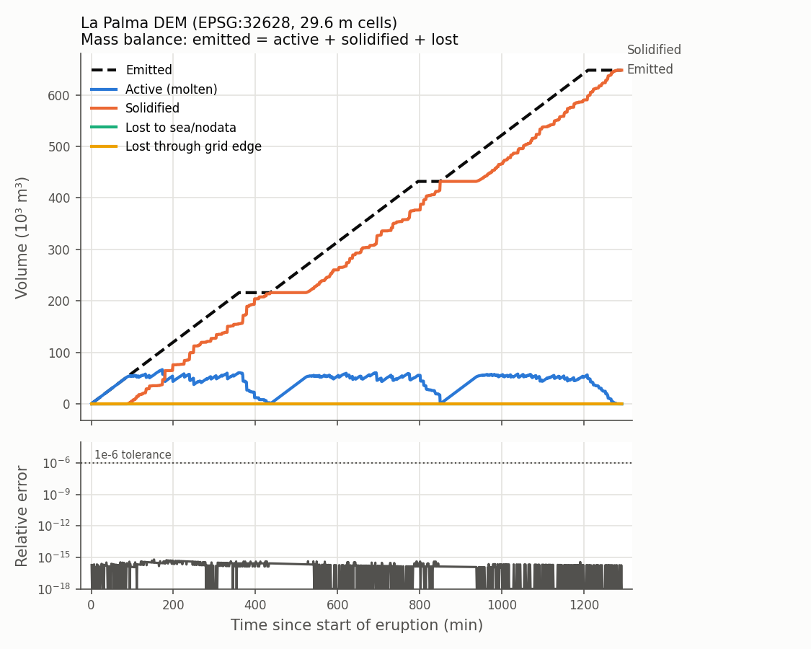

# La Palma Lava Flow Simulation

A simple cellular-automaton (CA) lava flow simulator, inspired by the 2021 eruption of
Cumbre Vieja (La Palma, Canary Islands). It runs on a synthetic Gaussian hill or on a
DEM of La Palma.

> **Status.** This is an educational/exploratory model. Its parameters are illustrative
> and **have not been calibrated**, and its output **has not been validated** against
> observed lava flows. See [Limitations](#limitations).


*Example run on the La Palma DEM (command below): molten + solidified lava thickness
over a hillshade of the pre-eruption DEM, after three 6-hour pulses at 600 m³/min.
Uncalibrated parameters.*

## What the model does

The DEM is a regular grid of square cells of side `L` (m). Time advances in steps of
`dt = 1 min`. Each cell stores the active (molten) lava thickness `h`, the heat
content `h·T`, and the solidified lava thickness `s`. Every step does the following:

1. **Emission.** The vent cell receives `Q·dt / L²` of lava at the eruption
   temperature `T0`.
2. **Newtonian cooling.** `T ← Ta + (T − Ta)·exp(−k·dt)`, applied to every cell holding
   lava.
3. **Viscosity and mobility.** Viscosity follows an Arrhenius-type (exponential)
   law, `μ(T) = μ_ref·exp(β·(T0 − T))`. Mobility is the local, bounded ratio
   `m(T) = μ(T0)/μ(T) = exp(−β·(T0 − T))`, in (0, 1]. Freshly erupted lava has
   mobility 1. Mobility falls as the cell cools and depends only on the cell's own
   temperature. `μ_ref` cancels out, so only `β` matters.
4. **Flow (CA rule).** A cell with lava compares its surface `z + s + h` with its 8
   neighbours. It releases `flow_coef · m(T) · min(h, Δz_max / 2)` and splits it
   among the lower neighbours in proportion to the slope (drop / distance;
   diagonals are √2 cells away). The `Δz_max / 2` cap keeps a cell from overshooting
   below its lowest neighbour. All cells update simultaneously.
5. **Heat advection.** Each volume `q` that moves from A to B carries heat `q·T_A`.
   B ends up at the volume-weighted mean temperature of its existing lava and the
   incoming lava. Cells without lava are at ambient temperature.
6. **Sinks.** Lava that reaches a nodata cell, a cell at or below sea level, or
   the edge of the grid leaves the domain. It is recorded as *lost to sea/nodata* or
   *lost through the grid edge*.
7. **Solidification threshold.** When a cell's temperature drops to `Ts` or below,
   all of its lava becomes solid. Deposits stay as topography for later steps and
   pulses.

The mass balance `emitted = active + solidified + lost to sea + lost through edge` is
tracked every step. The tests require it to close with relative error < 1e-6. In
practice the error is ~1e-16 (float64 round-off).

Only the cells near the lava are processed: the bounding box of cells with lava, plus
a one-cell margin. The example run on the 1684 × 1076 La Palma grid (1292 simulated
minutes) takes about 22 s, including reprojection, figures and GIF.

### Georeferencing

- `data/DEM_LaPalma.tif` is in Web Mercator (EPSG:3857), with ~31 × 35 m pixels in
  map units. Web Mercator distances are not ground distances (they are scaled by
  ~1/cos(latitude)). The DEM is therefore reprojected with `rasterio.warp` (bilinear)
  to **UTM zone 28N (EPSG:32628)**. The cell size (29.6 m with GDAL's default
  resolution) is read from the transform. `--cell-size` overrides it, with a
  warning. `--resolution` sets the target resolution.
- The vent is read from layer `emision_pto` of `data/Emission_Pt.gpkg` and
  reprojected to the DEM's CRS. The script stops with an error if the vent falls
  outside the DEM, on nodata, or on the sea.
- **Note on the vent location.** The `emision_pto` point (28.6253 N, 17.8403 W;
  1266 m in the reprojected DEM) is 2.9 km ENE of, and 316 m higher than, the point in
  the other layer of the same file, `2836460n_1751580w` (28°36'46"N 17°51'58"W). Check
  which point represents the 2021 vents before drawing conclusions from the
  simulated path. Use `--emission-layer` to switch.

## Quick start

```bash
python -m venv .venv && source .venv/bin/activate
pip install -r requirements.txt
python -m pytest            # 16 tests
```

Synthetic Gaussian hill (100 × 100 cells, 10 m, vent at the summit, default
parameters):

```bash
python src/lava_flow_simulation_palma.py --mode gaussian
```

La Palma DEM. This is the command used for the figures in `docs/figures/`: three
6-hour pulses at 600 m³/min (10 m³/s), each followed by up to 4 h without
emission:

```bash
python src/lava_flow_simulation_palma.py --mode real --rate 600 --pulses 3 \
    --pulse-minutes 360 --max-minutes-per-pulse 600 --snapshot-every 30
```

Run `python src/lava_flow_simulation_palma.py --help` for all options, including
the physics parameters (`--cooling`, `--beta`, `--initial-temp`,
`--solidification-temp`, `--flow-coef`).

### Outputs (`output/<mode>/`, not versioned)

| File | Content |
|---|---|
| `final_thickness.png` | Molten + solidified thickness over a hillshade |
| `mass_balance.png`, `mass_balance.csv` | Emitted / active / solidified / lost volumes and relative error, per minute |
| `summary.json` | Arguments, parameters, grid, vent, footprint area, run-out, final mass balance |
| `animation.gif` | Thickness snapshots (omit with `--no-gif`) |

Run-out in `summary.json` is the straight-line distance from the vent to the
farthest cell in the footprint. It is not a distance measured along the flow path.



## Default parameters (illustrative, uncalibrated)

| Parameter | Default | Note |
|---|---|---|
| Eruption temperature `T0` | 1150 °C | |
| Ambient temperature `Ta` | 25 °C | |
| Solidification threshold `Ts` | 900 °C | |
| Cooling constant `k` | 0.003 min⁻¹ | Lava that doesn't remix reaches `Ts` ~84 min after eruption |
| Viscosity slope `β` | 0.02 °C⁻¹ | `μ(Ts)/μ(T0) = e⁵ ≈ 150` |
| Flow coefficient | 0.45 | Fraction of the movable lava released per step |
| Effusion rate | 1000 m³/min | Per pulse; 3 pulses × 60 min by default |
| Sea level | 0 m | Cells ≤ 0 m and nodata are sinks |

None of these values were fitted to data. In particular, `k` was lowered from
0.03 to 0.003 min⁻¹ only so that flows don't freeze within minutes of leaving the
vent. That choice is not an estimate of the real cooling rate.

## Limitations

- **Illustrative parameters, no calibration.** No parameter has been fitted to
  observations of the 2021 eruption, and the effusion rates used are not the
  eruption's measured effusion history.
- **No quantitative validation yet.** The simulated footprint has not been compared
  with the mapped 2021 flow outlines (for example, the Copernicus EMS products), so
  no accuracy can be claimed.
- **Simplified rheology.** The model has no yield strength (Bingham or
  Herschel–Bulkley), so lava keeps spreading into ever-thinner layers until it
  solidifies. It also has no crust formation, no channels or lava tubes, and no
  thickness-dependent cooling.
- **Bulk thermal model.** A cell has a single temperature, and Newtonian cooling
  doesn't depend on thickness, radiation or crust. Solidification is all-or-nothing
  per cell, which causes step-like jumps in the solidified volume.
- **Grid and time-step dependence.** The CA rule is not derived from a discretised
  flow equation. The front advances at most one cell per minute, and results depend
  on cell size and `flow_coef`. No convergence study has been done.
- **Topography.** The DEM is pre-eruption and resampled twice: its original
  ~31 × 35 m Web Mercator grid was bilinearly reprojected to ~30 m UTM cells. Its
  source and acquisition date should be documented. Treating sea and nodata cells as
  sinks ignores lava deltas and offshore emplacement.
- **Vent.** A single point vent. The 2021 eruption had several vents, and its
  effusion rate changed over the ~85 days of activity.

## Repository layout

- `src/lava_flow_simulation_palma.py`: model, I/O and command-line interface.
- `tests/`: pytest suite covering georeferencing, propagation, mass conservation,
  symmetry, heat advection, mobility and a CLI smoke test.
- `data/`: input DEMs (`DEM_LaPalma.tif`, plus `DEM_gaussian.tif`, which the
  script doesn't use) and the emission point (`Emission_Pt.gpkg`). The Landsat 8 image
  and `output.png` belong to the legacy notebook.
- `docs/figures/`: example figures generated with the commands above.
- `notebooks/lava_flow_simulation_palma.ipynb`: the **original exploratory
  prototype**. It is self-contained (it also uses `scipy`), predates the fixes
  described here, and does not reflect the current model. Its side-by-side
  comparison with a Landsat image is qualitative only.
- `output/`: generated results (ignored by git).
